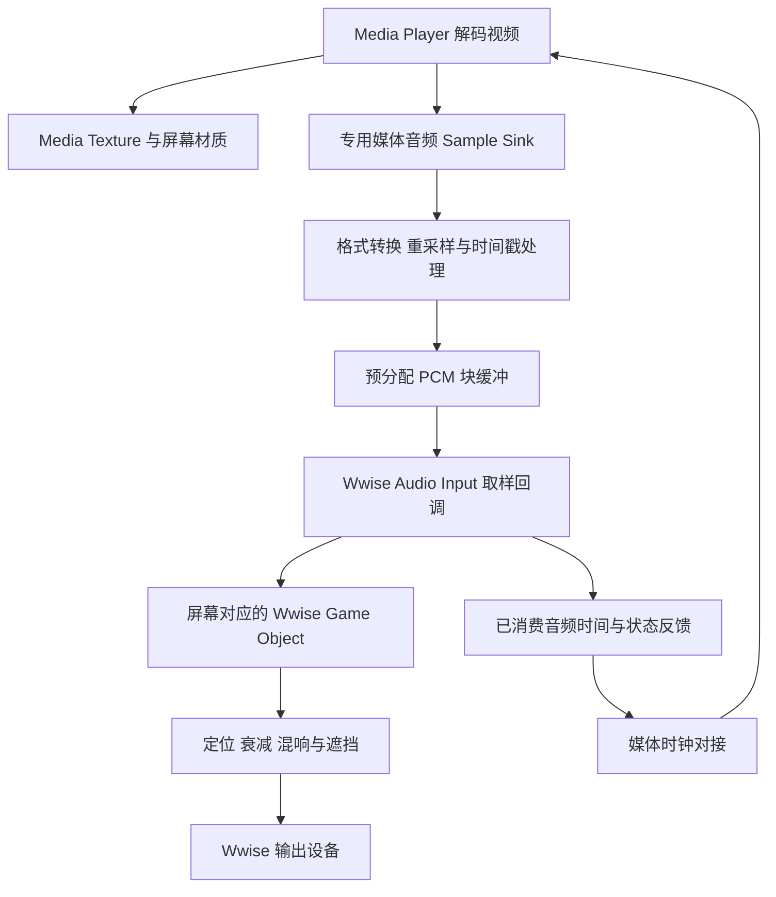

# UE5 视频音频通过 Wwise 实现三维声音技术方案

版本：1.2  
日期：2026 年 10 月 20 日  
适用项目：M2_Client  
面向读者：UE 客户端程序、音频程序、Wwise 音频设计和测试人员

## 1 方案结论与目标

保留 UE Media Player 的视频播放和画面输出，从 Media Framework 接收视频音轨解码后的 PCM 音频，经格式转换和有界缓冲送入 Wwise Audio Input。把 Audio Input 组件挂在场景中的屏幕或扬声器位置，由 Wwise 完成空间定位、距离衰减、混响及遮挡处理。

这里的“转为 3D”是把原有音轨作为场景声源进行空间渲染，不会从一个混合好的视频音轨中自动分离人物、车辆等多个独立声源。默认把一台电视视为一个发声位置；视频中的所有声音都从该位置发出。若需要视频内不同物体分别定位，必须有分轨素材、独立声音事件或额外的内容制作流程。

本项目推荐以直接接入 Audio Input 为主方案，复用已经存在的 `Audio_Input_ScreenVideo` 声音和事件。AudioLink 保留为替代方案，在单声源映射和 Media Sound 兼容性经过验证后再选用。首版支持本地视频、正常速度播放、暂停、恢复、跳转、循环和多个独立屏幕；变速、倒放、直播及复杂传播可分阶段扩展。

交付形式确定为独立的 UE 项目插件 `WwiseMedia`，内部使用 `WwiseMediaRuntime` 运行时模块，并依赖现有 Wwise 集成。开发目录为 `G:/M2_Wwise/WwisePlugins/WwiseMedia`；完成开发和验证后，将可交付插件接入 `H:/H3D_M2_Stream/game/client/Plugins/WwiseMedia`。开发阶段的代码归属在独立插件中，具体接入约定见第 4.3 节。

本文是实施设计。2026-10-20 已实现 WwiseMedia 0.1.0 首版，实际组件名为 `UWwiseMediaAudioComponent`，通过 UE 5.8.3/Wwise 2025.1.10 编译和核心 PCM 自动化测试。原设计中的 `UVideoWwiseAudioComponent` 名称及示例仅用于说明架构；实际 API、验证范围和剩余场景验收见开发目录中的 `README.md` 与 `Docs/DevelopmentStatus.md`。完整视频到 Wwise 的运行时效果及下文验收指标仍需实机验证。

## 2 项目现状与可复用资源

### 2.1 版本和配置

| 项目 | 核验结果 | 对实施的影响 |
|---|---|---|
| UE 引擎 | 本机 `Build.version` 为 5.8.3 | 按本机源码接口实现 |
| 引擎目录 | `F:/UE5/UE_5.7_T3/Engine` | 目录名称含 5.7，但版本文件为 5.8.3 |
| Wwise UE 集成 | 2025.1.10.9233.4458 | 已提供 Audio Input 和 AudioLink 源码 |
| Wwise 工程 | `H:/H3D_M2_Stream/client_wwise/M2_Wwise.wproj`，版本 2025.1.10 | 与集成的主要版本一致 |
| Windows 音频初始化 | 48000 Hz，`SamplesPerFrame=512` | 建议桥接输出固定为 48 kHz |
| Wwise SoundEngine | 配置启用 | 可直接使用 Audio Input，不必为此启用 AudioLink |
| AudioLink | `bWwiseAudioLinkEnabled=False` | 当前未启用，不能作为已经可用的链路 |
| AkAudioMixer | `bAkAudioMixerEnabled=False` | 主方案不以该路由为前提 |
| 业务模块 | `M2_Client.Build.cs` 已依赖 `AkAudio` | 桥接所需依赖由 `WwiseMediaRuntime` 自行声明；业务模块按调用方式引用插件 |

配置中的 `AudioInputEvent=Play_UnrealInput` 是另一项既有配置，不能据此认为视频已经自动接入。本文使用屏幕视频专用事件，避免混淆用途。

### 2.2 已存在的屏幕视频资源

| 资源 | 当前名称或状态 | 建议处理 |
|---|---|---|
| Sound | `Audio_Input_ScreenVideo` | 优先复用 |
| 音源插件 | `Wwise Audio Input`，并已设为活动音源 | 核对目标平台插件可用 |
| 播放事件 | `Play_Audio_Input_ScreenVideo` | 赋给自定义 Audio Input 组件 |
| 停止事件 | `Stop_Audio_Input_ScreenVideo` | 如使用，核对 Action 的作用范围；单实例控制优先使用 Playing ID |
| 定位属性 | Sound 中存在 `3DSpatialization` 设置 | 在 Wwise 中核对继承、混合比例和运行时定位效果 |
| 衰减引用 | `AMB_50m` | 按实际曲线复核，不能只按名称判断 |
| 输出总线 | `Audio_Input_ScreenVideo` | 复用其音量管理和监测能力 |
| 混响发送 | 该总线存在向 `Hall_Large` 的 User Aux Send，值为 -15 dB | 区分固定大厅混响和随房间变化的环境混响 |
| 电平监测 | 总线上有 `Audio_Input_ScreenVideo_Meter` | 可辅助确认 Wwise 已收到有效声音 |
| UE 事件资源 | 播放和停止事件的 `.uasset` 已存在 | 检查资源引用、加载和打包 |
| Windows 生成数据 | 存在该播放事件的 SoundBank 元数据 | 不能替代运行时加载成功检查 |

播放事件 UE 资源路径：

```text
/Game/WwiseAudio/Events/AudioInput/AudioInput/Audio_Input_ScreenVideo/Play_Audio_Input_ScreenVideo
```

当前 `AMB_50m` 的 `RadiusMax` 为 `2000`，生成数据中的 `MaxAttenuation` 也是 `2000`。在常见的 UE 厘米坐标直接传递方式下，这相当于 20 米；最终应结合项目的坐标转换、Listener Scaling 和运行时距离测量确认，不能直接认定是 50 米。

该衰减资源还配置了近距离较大的 Spread，以及遮挡音量曲线。一些滤波曲线虽然保留了点数据，但其 `CurveToUse` 为 `None`，不能据此认为“隔墙变闷”已经启用。后续应在 Wwise 界面和 Profiler 中检查实际生效值。

### 2.3 本次方案的实施边界

主要新增工作是 UE 中的媒体音频桥接、时钟对接、播放状态管理和验收。现有 Wwise 声音资源可以作为起点，但仍要核对定位、虚拟声部、衰减、混响发送和打包行为。本文不要求重建整套 Wwise 工程，也不修改现有项目的全局音频路由。

## 3 接入路线比较

| 路线 | 音频经过的链路 | 优点 | 主要成本或限制 |
|---|---|---|---|
| 直接 Audio Input | Media Framework → 自定义桥接 → Wwise | 每屏幕独立控制，保留时间戳，可管理同步和缓冲 | 需要 C++ 开发 |
| AudioLink | Media Sound 或兼容音源 → UE 音频链路 → AudioLink → Wwise | 可复用已有桥接和缓冲实现 | 需要验证 Media Sound 的接入方式、Wwise 声源映射和额外延迟 |
| 离线分离音轨 | UE 播视频，Wwise 单独播放提取音轨 | 固定短视频可较快接入 | 两套播放时间线需要同步，跳转和变速更复杂 |

本项目先按直接 Audio Input 设计。它适合屏幕作为独立声源，也能明确处理视频暂停、跳转、切换和销毁。固定演示片且无交互时，可以另行评估分离音轨方案。

Audio Input 是接收 PCM 的接口，不负责打开 MP4、不负责解码 AAC，也不会自动读取 `UMediaPlayer`。External Source 也不是把视频音轨自动送入 Wwise 的同义接口。

## 4 总体架构



画面和声音来自同一个 Media Player。画面继续按原方式输出，声音从解码采样进入 Wwise，不必先经过 UE Master Submix。

每个独立播放实例应拥有自己的桥接状态、缓冲、时钟、Playing ID 和 Wwise 发声组件。Wwise Event 资产可以共用，播放实例必须区分。

### 4.1 建议的代码职责划分

以下名称是拟议设计，可以按项目命名规范调整。

| 对象 | 职责 | 所在线程或执行域 |
|---|---|---|
| `UVideoWwiseAudioComponent` | 继承 `UAkAudioInputComponent`，提供蓝图控制和场景声源 | 生命周期与控制在游戏线程；取样函数由 Wwise 调用 |
| `FVideoMediaAudioBridge` | 持有媒体采样队列、转换器、时间戳及转换任务 | 媒体接收链路和转换工作线程 |
| `FVideoPcmBlockQueue` | 保存固定格式 PCM、媒体时间戳和播放代次 | 单生产者与单消费者之间传递 |
| 播放协调器 | 统一处理打开、播放、暂停、跳转、循环和关闭 | 游戏线程 |
| 调试状态快照 | 提供缓冲量、欠载、时钟差和事件状态 | 音频侧写入，游戏线程读取 |

音频回调应使用具有明确生命周期的共享状态。不要只用裸 `this` 绑定自定义异步任务，再假定 Actor 销毁后不会收到回调。

### 4.2 第一阶段格式约定

| 参数 | 首版约定 |
|---|---|
| 桥接输出采样率 | 48000 Hz |
| 声道数 | Mono，用于单个屏幕或电视点声源 |
| 采样格式 | 32 位 float PCM |
| Wwise 输出缓冲布局 | `BufferToFill[Channel][Frame]`，按声道分开 |
| 播放速度 | 1.0；暂停单独处理 |
| 每个实例 | 一个 Audio Input Playing ID，一个发声位置 |

Wwise 的系统输出仍然可以是立体声或环绕声。输入使用 Mono 不等于最终只能从一个扬声器播放，Wwise 会根据监听者和声源的位置分配到输出声道。

### 4.3 插件目录与客户端接入约定

插件名称固定为 `WwiseMedia`，是 UE 侧的媒体音频桥接插件。它不是 Wwise Authoring 的音源插件，也不在 Wwise 的 `AkAudio` 模块中新增业务实现。

| 用途 | 路径或名称 |
|---|---|
| 开发源目录 | `G:/M2_Wwise/WwisePlugins/WwiseMedia` |
| 插件描述文件 | `WwiseMedia.uplugin` |
| 运行时模块 | `WwiseMediaRuntime`，类型为 Runtime |
| 完成后的客户端接入目录 | `H:/H3D_M2_Stream/game/client/Plugins/WwiseMedia` |
| 外部依赖 | 现有 Wwise 插件，以及 UE 的 Media Framework 等模块 |

建议目录结构：

```text
G:/M2_Wwise/WwisePlugins/WwiseMedia/
  WwiseMedia.uplugin
  Source/
    WwiseMediaRuntime/
      WwiseMediaRuntime.Build.cs
      Public/
        VideoWwiseAudioComponent.h
      Private/
        VideoWwiseAudioComponent.cpp
        VideoMediaAudioBridge.h
        VideoMediaAudioBridge.cpp
        VideoPcmBlockQueue.h
        WwiseMediaRuntimeModule.cpp
  Docs/
    README.md
```

目录结构是后续开发约定，不表示这些文件已经生成。首版以一个 Runtime 模块交付；只有确实需要专门的资产编辑器、详情面板或其他编辑器功能时，再增加独立的 `WwiseMediaEditor` 模块。

`WwiseMediaRuntime` 继承和调用 `AkAudio` 已提供的 Audio Input 接口，集中实现采样、转换、同步、控制和清理。插件描述文件声明对 Wwise 插件的依赖，模块依实际使用声明 `AkAudio`、`WwiseSoundEngine`、`MediaAssets`、`MediaUtils` 和 `Media` 等依赖。Runtime 代码不引入 UnrealEd 或 Wwise Authoring 运行依赖。

插件通过可配置的 Media Player 和 `UAkAudioEvent` 引用接入业务，不把当前项目的事件路径、视频路径或 G 盘和 H 盘的绝对路径写死在运行时代码中。当前屏幕视频事件由测试或业务配置赋给组件，因此插件可以在独立测试宿主和客户端中使用。

开发和接入按以下顺序进行：

1. 在 G 盘开发目录完成插件源码、接口和使用说明，通过独立测试宿主或指定测试工程加载插件。
2. 使用匹配的 UE 与 Wwise 版本，完成编译及第 18 节中适用于首版的功能、同步、生命周期和打包验收，并记录尚未覆盖的平台与场景。
3. 形成可交付版本，保留开发目录，将插件源码、描述文件和必要资源复制到客户端 `Plugins/WwiseMedia`。不把开发机的 Intermediate、Saved 等临时目录作为交付内容；Binaries 按源码编译或匹配目标环境的预编译发布方式处理。
4. 在客户端启用插件，配置现有 Wwise 事件和 Media Player，完成客户端编译、场景验证及打包复验。

开发完成前，客户端 `Plugins` 中不提前落入半成品，也不通过修改现有 Wwise 插件源码来承载桥接实现。正式接入后，开发目录与客户端目录应标明一致的版本，避免两份代码各自演进且无法对应。

## 5 Wwise 编辑器配置

### 5.1 核对声音和事件

1. 打开 `M2_Wwise.wproj`，找到 `Containers/System` 中的 `Audio_Input_ScreenVideo`。
2. 确认当前活动音源是 `Wwise Audio Input`。
3. 确认 `Play_Audio_Input_ScreenVideo` 的 Play Action 指向该 Sound。
4. 检查声音是否被父级、State、Switch、RTPC、Mute 或总线音量影响。
5. 确认播放事件、依赖对象及所需插件被包含在目标平台生成数据中。
6. 生成对应平台 SoundBank，在 UE 中更新或协调 Wwise 资源，并确认实际使用的生成目录。

无需为这个 Audio Input 声音导入整段视频音轨。音轨仍由 UE 媒体后端解码。Sound 上既有的 Conversion 引用也不代表运行时 PCM 会先被编码为 Vorbis。

### 5.2 配置空间定位

在 Sound 的 Positioning 设置中，检查有效的 3D Spatialization、Speaker Panning 与 3D Spatialization 的混合比例，以及 Listener Relative Routing 等相关设置。具体中文名称随 Wwise 编辑器语言变化。

先用低 Spread 或关闭近距离扩散的测试配置验证方向，再恢复需要的声源宽度。当前衰减资源近距离 Spread 较大，可能让声音显得更宽，不能把这种听感直接判断成“没有进入 3D”。

声源位置由 UE 中对应 Ak 组件提供。检查实际 Listener 是玩家摄像机、角色还是项目自定义对象；检查它是否随镜头移动和旋转。距离衰减可以正常但方向仍错误，二者需要分别验证。

普通扬声器声像定位可先作为基线。耳机中的前后和上下定位若要求更明确，应再评估目标平台的 HRTF、空间输出或其他 binaural 渲染方案，不能只因为勾选 3D 就承诺完整耳机三维定位。

### 5.3 配置距离衰减

在 `AMB_50m` 中核对音量曲线、最大距离、Spread 和相关环境曲线。建议为视频专用调音复制一份衰减资源，避免调整共享资源时影响其他环境声。

先测量 UE 场景中已知的 1 米和 10 米距离，再对照 Wwise Profiler 中的距离值。确认单位后，由音频设计确定近场范围和最大可听距离。不要同时在 UE 和 Wwise 叠加两套距离衰减，否则会出现衰减过快或不同实例行为不一致。

### 5.4 配置混响

项目的视频总线目前有固定发送到 `Hall_Large` 的设置。它可以形成大厅混响，但不等于根据屏幕所在房间自动切换环境。

若所有屏幕都位于同一大厅，可先复用该固定发送。若需要进入浴室、走廊或其他房间时变化，应配置对应 Aux Bus，并通过 Wwise 的 Game-defined Auxiliary Sends、Ak 环境组件或 Spatial Audio Rooms 等链路驱动。核对组件允许环境发送、Sound 的有效发送设置和 Aux Bus 效果。

在引入动态环境发送时，检查原有固定发送是否仍然需要，避免两路混响叠加。UE 原生 Audio Volume 中的混响设置不会自动处理直接进入 Wwise 的 PCM。

### 5.5 配置遮挡和复杂传播

隔墙效果需要两个部分共同完成：UE 或 Wwise Spatial Audio 提供遮挡与传播信息，Wwise 根据有效曲线改变音量和滤波。

简单隔墙方案使用 Ak 组件的遮挡检测或项目射线逻辑，配置碰撞通道和刷新频率。复杂室内传播再引入 Rooms、Portals 和必要的几何数据。不要让自定义射线、Ak 遮挡和几何传播重复施加同一项衰减。

当前 `AMB_50m` 的遮挡音量曲线可以衰减声音，但 LPF 使用状态需要重新核对；要实现“变闷”，必须确认实际启用了相应滤波曲线。

## 6 UE 场景与资源接入

建议的场景结构：

```text
BP_VideoScreen
  SceneRoot
    ScreenMesh                     显示 Media Texture
    VideoWwiseAudioComponent        放在扬声器或屏幕发声中心
```

Media Player 可以由 Actor、组件或现有业务系统持有。需要确保其生命周期覆盖所有音频回调，并通过 `UPROPERTY` 或适当资源持有方式避免被意外回收。

主方案必须做到：

1. 关闭该播放器的 `NativeAudioOut`，避免由操作系统原生音频路径直接出声。
2. 不让同一个 Media Player 同时被活动的原生 `Media Sound Component` 和自定义桥接竞争消费。
3. 画面继续使用原来的 Media Texture 和材质，不需要为 3D 音频更换显示方案。
4. 将屏幕专用播放事件赋给自定义组件的 `AkAudioEvent`。
5. 确认 Wwise 初始化、事件资源加载和组件注册完成后，再发起 Audio Input 播放。
6. 由统一控制入口驱动 Media Player 和音频桥接，不分别暴露两套互不关联的 Play 或 Seek。

不要为了禁止 UE 原声，直接把待采集音频数据的幅度归零。直接采样方案应通过不建立原生发声路径避免重复播放；使用 Submix 或 AudioLink 时，要在正确的分流位置处理原声输出。

## 7 视频音频采集

### 7.1 使用 Media Framework 的 Sample Sink

本机 UE 5.8.3 存在以下接口：

```cpp
UMediaPlayer::GetPlayerFacade()
FMediaPlayerFacade::AddAudioSampleSink(...)
FMediaAudioSampleQueue
IMediaAudioSample
```

初始接入逻辑可以参考：

```cpp
// 示例仅展示注册关系，不是完整组件。
// MaxQueuedPackets 必须是经过设计的正值。
SampleQueue = MakeShared<FMediaAudioSampleQueue, ESPMode::ThreadSafe>(
    MaxQueuedPackets);

MediaPlayer->GetPlayerFacade()->AddAudioSampleSink(
    SampleQueue.ToSharedRef());
```

`FMediaAudioSampleQueue` 定义在 `MediaSampleQueue.h` 中，不是 `MediaAudioSampleQueue.h`。使用 `MediaPlayer.h`、`MediaPlayerFacade.h`、`MediaSampleQueue.h` 和 `IMediaAudioSample.h` 等头文件，按声明实际位置配置模块依赖。

`IMediaAudioSample` 提供 `GetBuffer()`、`GetChannels()`、`GetFrames()`、`GetFormat()`、`GetSampleRate()`、`GetTime()` 和 `GetDuration()`。必须读取这些信息，不能假设每个后端输出的都是 48 kHz float 立体声。

音频内存指针只在对应 Sample 的生命周期内有效。跨线程转交时要保留 Sample 的共享引用，或复制到自己管理的预分配缓冲，不能缓存裸指针后提前释放 Sample。

### 7.2 重要约束是主音频接收端

本机 `FMediaPlayerFacade::ProcessAudioSamples` 中，使用 `UsePlaybackTimingV2` 的链路只向 `PrimaryAudioSink` 供数。`GetPrimaryAudioSink()` 选取第一个有效接收端。

因此，不能默认“原生 Media Sound 已经在播，再加一个 Sink 也一定能拿到同一份音频”。在这些后端上，自定义桥接必须成为实际的主音频接收端。同一个播放器有多个无效或停止消费的接收端时，还可能造成解码器反压或音画停滞。

首版采用单一接收端：直接桥接负责消费该播放器的音频，不再绑定活动的原生 Media Sound。播放器切换时需要重新建立正确的注册关系，并排查旧队列是否仍有强引用。

当前 Facade 的公开头文件中没有与添加接口对称的 `RemoveAudioSampleSink`。停止时应释放桥接持有的队列引用和自定义委托，遵循 Facade 对弱引用失效队列的清理机制；不要编造一个不存在的移除接口。释放顺序和线程退出必须由桥接层保证。

### 7.3 处理媒体事件与 Flush

Sample Sink 链路提供关闭、播放结束、速度变化和 Flush 等事件，队列还提供 `GetFlushCount()`。应把这些变化纳入状态管理，而不是只处理业务蓝图主动调用的 Seek。

后台发生 Flush 时，转换器内部残留输入和已转换 PCM 都可能过期。通过播放代次和 Flush Count 标记数据，在消费者端拒绝旧数据，避免跳转后播放上一段视频的尾音。

队列上限的单位是 Sample Packet 数量，不是音频帧数，也不是毫秒。要同时统计队列对应的媒体时长，才能判断实际延迟。

## 8 PCM 转换与缓冲

### 8.1 转换步骤

1. 读取实际采样格式，将整数或其他支持类型规范化为 float。
2. 按声道布局完成下混。立体声转 Mono 的基础形式是 `0.5 * L + 0.5 * R`，需要检查反相素材的抵消问题。
3. 对 5.1 等多声道内容使用明确的下混矩阵，正确处理 Center、Surround 和 LFE，不能只截取前两个声道。
4. 将输入采样率重采样到 48000 Hz，并保留连续的重采样状态。
5. 为输出 PCM 块保留媒体时间戳、有效帧数、播放代次和必要的跳变信息。

本机 `FMediaAudioResampler` 提供 `Initialize`、`Generate` 和 `Flush`，可作为复用或参考起点；原生 `FMediaSoundGenerator` 已展示它如何处理输出格式、时间戳和跳变。复用前仍要核对素材支持范围、线程约束、动态分配和目标平台行为。

仅将 `AudioFormat.uSampleRate` 写成 48000 不会完成重采样。错误声明输入速率会直接造成速度、音高或持续同步偏差。

### 8.2 有界缓冲设计

推荐把格式转换放在单独的转换任务中，生产预分配的 PCM 块；Wwise 回调只消费这些块。这样不会把较重的转换、样本释放或内存分配集中在 Wwise 音频线程。

PCM 队列采用单生产者单消费者设计时，生产者只推进写入端，消费者只推进读取端。游戏线程不得在 Seek 时直接并发清空其内部读写指针。通过命令、代次和消费者确认安全地切换数据。

如果采用直接在 Wwise 回调中使用媒体队列和重采样器的简化原型，可以减少一层缓冲，但必须测量锁竞争和内存分配。它不是未经性能验证即可上线的替代实现。

建议使用时间长度规划缓冲，首轮实验可从 20 至 40 ms 的预缓冲和 100 至 200 ms 的容量上限开始。它们是调优起点，不是 Wwise 固定要求，也不是本项目已测结果。

```text
缓冲时长 ms = 已排队音频帧数 / 输出采样率 * 1000
PCM 内存字节 = 音频帧数 * 声道数 * sizeof(float)
```

例如 48 kHz、Mono、100 ms 的 PCM 数据约为 19200 字节，不含块元数据和媒体解码队列。

### 8.3 欠载与过载

欠载时，先输出已就绪的数据，不足部分补零，记录欠载帧数和次数。补零不等于已经播放了真实媒体内容，不能无条件用补零帧数推进媒体位置。由同步策略决定等待、重缓冲或跳过过期媒体段。

过载时停止转换器继续预生成，给上游形成有界反压。确实需要丢弃数据时，应按完整帧或带时间戳的数据块处理并触发同步恢复，避免删除半个交错音频帧产生声道错位。

部分解码器的音频包池有限。长时间保留不消费的 Sample 可能阻塞解码，不能通过无限增大队列掩盖消费问题。

## 9 Wwise Audio Input 接口实现

### 9.1 组件与启动入口

`UAkAudioInputComponent` 是抽象类，不能仅在蓝图里直接补齐原生纯虚函数。需要一个 C++ 子类实现 `GetChannelConfig` 和 `FillSamplesBuffer`，然后把该子类暴露给蓝图使用。

启动时调用：

```cpp
PostAssociatedAudioInputEvent();
```

该入口把组件的 `AkAudioEvent`、采样回调和格式回调一起传给 `FAkAudioInputManager`，并使用本组件作为 Wwise Game Object。不要只用普通 Post Event 入口替代，否则不会自动建立这份音频采样绑定。

保存返回的 Playing ID，并阻止同一实例重复启动。需要更细的管理时，可以直接使用 `FAkAudioInputManager::PostAudioInputEvent` 的组件重载，但要自行承担绑定、停止和生命周期管理。

### 9.2 固定输出格式

```cpp
// 示例约定：上游已转换为 48 kHz Mono float PCM。
void UVideoWwiseAudioComponent::GetChannelConfig(
    AkAudioFormat& AudioFormat)
{
    AudioFormat.uSampleRate = 48000;
    AudioFormat.channelConfig.SetStandard(AK_SPEAKER_SETUP_MONO);
}
```

先固定桥接输出格式，再发布事件。不要在同一个活动 Playing ID 中任意更改声道数或采样率；素材变化时优先由转换层继续维持固定格式。确需改变输出格式，应停止并重新建立输入实例。

### 9.3 取样回调约定

```cpp
// 逻辑示意，不是可直接编译的完整代码。
// PopCurrentEpochMonoFrames 和 PublishConsumedMediaTime
// 是桥接层需要实现的方法，不是 UE 或 Wwise 自带接口。
bool UVideoWwiseAudioComponent::FillSamplesBuffer(
    uint32 NumChannels,
    uint32 NumSamples,
    float** BufferToFill)
{
    for (uint32 Channel = 0; Channel < NumChannels; ++Channel)
    {
        FMemory::Memzero(
            BufferToFill[Channel], NumSamples * sizeof(float));
    }

    if (NumChannels != 1 || !SharedState->CanConsumeAudio())
    {
        return true;
    }

    FConsumedAudioInfo Consumed;
    SharedState->PopCurrentEpochMonoFrames(
        BufferToFill[0], NumSamples, Consumed);

    // 只发布实际消费的媒体音频时间。
    // 游戏线程或专门的时钟适配层负责对接 Media Framework。
    SharedState->PublishConsumedMediaTime(Consumed);
    return true;
}
```

示例中的共享状态、并发保护、停止协议和数据类型均需实现。生命周期协议必须保证回调期间 `SharedState` 有效，不能把空指针检查当作完整的销毁保护。

在这份 Wwise 集成中，`NumSamples` 实际由 `AkAudioBuffer::MaxFrames()` 传入，表示每声道请求的帧数，不是所有声道的总采样值数量。每个声道都要完整初始化。

`float**` 是按声道分开的缓冲。双声道输入若为 `L0 R0 L1 R1` 的交错布局，需要转换为左右声道分别填充，不能直接整块复制给 `BufferToFill[0]`。

### 9.4 不使用返回 false 作为通用停止方式

本机组件头文件的注释称返回 false 会停止事件，但实际 `AkAudioInputManager.cpp` 把 false 映射为 `AK_NoDataReady`。两者不一致。

因此，暂时无数据时采用完整补零并返回 true 的明确策略；正式停止由游戏线程执行停止实例的流程。不要依赖回调 false 表示 EOF，也不要在回调里直接销毁组件。

`FAkAudioInputManager::Stop` 当前实现只移除内部委托映射，不等同于完整的声音停止。使用组件封装的停止路径，或明确先停止对应 Playing ID 再处理委托与资源。基类 `Stop()` 在该头文件中位于 protected，面向蓝图的停止入口应由子类提供包装。

## 10 线程与生命周期

游戏线程负责 UObject 操作、状态变化、场景位置、事件启动和停止。媒体线程负责交付 Sample。转换线程负责输入转换及 PCM 生产。Wwise 音频线程负责快速取样并发布消费快照。

Wwise 回调中不等待媒体打开、不读文件、不执行蓝图、不高频输出日志，也不分配随视频长度增长的内存。共享字段使用原子值、不可变快照或经过设计的消息机制传递；不把“线程安全共享指针”误认为其内部所有数据都自动线程安全。

关闭顺序建议如下：

1. 进入 Stopping 状态，使回调停止消费真实 PCM 并输出静音。
2. 禁止新转换任务写入当前实例，通知现有任务退出。
3. 在游戏线程发起该实例的 Wwise 停止操作。
4. 通过明确的回调退出和工作任务完成机制保证共享状态不再被访问。
5. 解绑业务与媒体事件，释放采样队列和 PCM 缓冲。
6. 释放播放器引用和其他实例资源。

该顺序是一项生命周期协议，需要与所选 Wwise 停止 API 的实际异步语义配合。不要认为停止调用一返回，全部音频回调就必然已经退出。Actor 销毁、关卡切换、PIE 退出和媒体打开失败都必须走可重复调用的清理路径。

## 11 播放状态与控制流程

建议使用 Closed、Opening、Priming、Playing、Paused、Seeking、Rebuffering、Ended、Stopping 和 Error 等明确状态。蓝图或业务脚本只调用统一的媒体播放控制层。

| 操作 | Media Player 行为 | 音频桥接与 Wwise 行为 |
|---|---|---|
| 打开视频 | 异步打开，确认选中了音轨 | 注册有效 Sink，创建新代次，预加载事件 |
| 首次播放 | 开始正常播放或按后端能力准备数据 | 格式固定且达到预缓冲后启动一个输入实例 |
| 暂停 | 暂停媒体 | 保持实例，回调补零且停止消费；保留可用的当前位置数据 |
| 恢复 | 恢复媒体 | 核对 PTS 与当前媒体位置，必要时重新预缓冲 |
| 跳转 | 发起 Seek，等待完成及目标位置数据 | 暂停真实输出，更新代次，丢弃旧数据并重置转换状态 |
| 循环 | 返回片头或播放器提供的循环时间线 | 识别序列变化，防止旧尾音和新片头交叉 |
| 切换视频 | 关闭旧源并打开新源 | 重建桥接关联，保持固定输出格式或重建实例 |
| 播放结束 | 确认后端的结束含义 | 按策略播完当前代次剩余有效音频，再停止实例 |
| 网络缓冲 | 后端进入等待或恢复 | 有界补零或进入重缓冲，恢复时按时间戳对齐 |
| 关闭或销毁 | 停止并释放播放器 | 执行完整生命周期清理 |

“预缓冲完成再启动”的实现不能造成循环等待：有些后端只有在进入播放后才持续提供音频。应先建立 Sink 并允许解码推进，再等待 PCM；不要等待一个只有 Wwise 回调启动后才会被生产的缓冲条件。

### 11.1 跳转必须同时处理三层数据

Seek 时要处理媒体 Sample 队列、转换器内部状态和已就绪的 PCM 队列。只清理最后一层，仍可能把旧的转换器输入重新写回队列。

建议每次打开、跳转或重建流时递增 `PlaybackEpoch`。每个 PCM 块带上该代次；消费者只输出当前代次数据。转换任务完成后也要再次核对代次，避免旧任务晚到后污染新缓冲。

`OnSeekCompleted` 只说明跳转操作完成到相应阶段，不代表目标位置的音频已经填满缓冲。还需检查新 Sample 的时间戳、Flush Count 和可用帧数。

### 11.2 变速和倒放

首版仅支持 1.0 倍速和暂停。后续若支持变速，媒体解码速率、时间戳映射和音频时间伸缩必须统一设计。仅改变 Wwise Pitch 会改变听感或消费速率，不能替代完整的视频同步。

倒放、直播和不可跳转流需要单独验证媒体后端能力。业务层应明确拒绝不支持的操作，避免界面显示成功但声音继续按原时间线播放。

## 12 音画同步设计

### 12.1 区分媒体位置与实际出声时间

需要区分四个时间：视频音频块的 PTS、PCM 转换完成时间、Wwise 取样回调消费时间，以及音频经过 Wwise 和设备缓冲后真正到达扬声器的时间。

不能在解码完成时就把“已经解码到这里”回报成“已经播放到这里”。也不能用 Actor Tick 的次数估算音频播放进度。音频消费速率由 Wwise 的音频时钟驱动。

建议以 Media Framework 原有的音频与视频同步机制为基础，把 Wwise 消费端接入原生音频渲染端的时钟职责。不要另外创建一个只靠游戏时间推进、与媒体时钟互不关联的计时器。

### 12.2 对接 UE 的音频时间反馈

本机原生 `FMediaSoundGenerator` 在生成声音后，会调用：

```cpp
FMediaAudioSampleQueue::SetAudioTimeIfEqualFlushCount(...)
```

`UMediaSoundComponent::UpdatePlayer` 还会把最后播放的采样时间传给：

```cpp
FMediaPlayerFacade::SetLastAudioRenderedSampleTime(...)
```

使用 Playback Timing V2 的媒体链路会读取主 Sink 的 `GetAudioTime()` 来决定视频处理时间范围。直接桥接接管了原生 Media Sound 的消费职责，也必须接管相关时钟反馈，否则可能不只是轻微不同步，而是无法继续正常处理画面。

实现时保留 PTS 和其对应的系统单调时间，用真实消费进度发布时钟快照。Flush 后使用 Flush Count 或代次防止过期时间覆盖新时间；暂停、结束和无数据时按原生语义维护或使时钟失效。旧版 Timing 与 Timing V2 的反馈路径要分别验证。

反馈的“本批音频起点”和“消费后游标”应与选用 API 的语义一致。它们不能混用。建议逐段对照本机 `MediaSoundComponent.cpp` 的实现，再为新增下游缓冲建立校正，而不是简单把 PCM 队尾 PTS 写给所有时间接口。

### 12.3 延迟预算与测量

端到端延迟来自媒体解码队列、转换缓冲、Wwise 处理缓冲和设备输出。当前 Windows 配置的一个 512 帧周期在 48 kHz 下约为 10.67 ms；这不代表总延迟只有 10.67 ms，实际还有多个缓冲及设备影响。

记录以下数据：当前已消费 PTS、队列时长、回调系统时间、估算输出延迟和画面显示时间。若时钟适配层补偿下游输出延迟，应明确补偿的时间基准和方向，并用闪光加脉冲音测试测出结果，不能把生产端 PTS 提前量作为补偿。

首轮可把稳定播放时音画偏差不超过约 ±40 ms、长片不出现持续累积漂移作为建议验收目标。该值需由产品与音频团队确认，并分别测试耳机、外放和实际目标设备；蓝牙等设备的延迟需要单独记录。

小幅漂移可通过受限的重采样调整平滑校正，大幅跳变进入重新预缓冲。禁止高频 Seek 或反复大幅调整 Pitch 来掩盖时钟错误。

### 12.4 调试测量素材

准备含可见闪光、短脉冲音和明确时间标记的测试视频，在片头、片中和片尾重复出现同步标记。使用录屏与录音或外部采集检查标记差，并记录测量链路自身的延迟。仅主观观看口型不足以作为长期同步验收依据。

## 13 虚拟声部与多个屏幕

### 13.1 不可听不能等同于停止媒体消费

声音距离过远、低于阈值或被 Voice Limit 管理时，Wwise 可能不再以原频率调用输入回调。若桥接完全依赖回调推进媒体时钟，可能导致缓冲填满、解码受阻，甚至画面停滞。该行为需要按有效的虚拟声部设置实测，不能假设所有情况下都会持续拉取。

首版先采用容易验证的设置：给视频声音足够的真实声部预算，核对低于阈值时的 Continue to play 行为，避免把活动视频随意 Kill。即使如此，也要测试总声部限制、优先级和全局限制。

生产优化阶段若允许远处视频虚拟化，需要独立维护媒体时间推进和有界丢弃策略，或明确地同时暂停画面和音频。重新可听时按当前视频位置重新对齐，不能继续播放离开前积压的音频。

### 13.2 不同视频与同一视频的不同实例

多个屏幕播放不同视频时，每个屏幕使用独立 Media Player、桥接状态和 Wwise 发声实例。它们可以共享 Event 资产，但不能共享一个可被破坏性读取的 PCM 消费队列。

多个屏幕显示同一个同步视频时，可以共用解码，随后由一个主消费端把 PCM 分发给多个发声实例。各发声实例需要独立读游标或独立输出缓冲，并规定谁负责媒体时钟。不能让多个 Wwise 回调轮流 Pop 同一份队列，否则每个屏幕都会丢失其他实例取走的数据。

共享视频总线的 Meter 反映汇总信号，不是每台屏幕的独立电平。实例定位和停止测试应同时使用 Game Object 和 Playing ID 观察。

## 14 AudioLink 替代方案

项目自带 `WwiseAudioLinkRuntime`，其中 `FWwiseAudioLinkInputClient` 最终也通过 `FAkAudioInputManager::PostAudioInputEvent` 将声音交给 Wwise。AudioLink 提供现成桥接，但仍需要正确接入源和配置声源归属。

现状是 AudioLink 配置关闭。若选择此路线，应先在独立测试场景验证以下事项：

1. UE Audio Mixer 与 Wwise AudioLink 所需模块、路由和设置实际生效。
2. `UWwiseAudioLinkSettings` 中的 `StartEvent` 指向正确的 Audio Input 事件。
3. Media Sound 生成的声音可以进入所选的 Source 或 Submix AudioLink 路径。
4. 输入实例映射到正确的 Wwise 组件，并随屏幕位置更新。
5. UE 原声输出被正确抑制，Wwise 接收到的数据仍然非零。
6. 两层音频缓冲的额外延迟满足音画同步要求。

本机 Source AudioLink 的工厂代码在启动时把 `OwningComponent` 转为 `UWwiseAudioLinkComponent`。因此，不能直接承诺“给任意 Media Sound 勾选一个选项，就会自动成为正确的 Wwise 三维声源”。需要核对该版本的所有者关系和创建路径。

Submix 路线拿到的是已经混合的音频。若多个视频先合成一路，再给 Wwise 一个 Game Object，Wwise 就无法恢复各屏幕独立的位置。为每屏幕建立独立子混音也会增加管理复杂度，并要检查 UE 是否已做过空间化和衰减。

旧 `AkSubmixInputComponent` 在本项目集成中已经标记 Deprecated，并提示使用 AudioLink。它可以作为源码参考，不作为新方案的默认组件。

## 15 打包与平台适配

开发阶段先在 Windows、本地可跳转视频、1.0 倍速下验证完整链路，再扩展平台与媒体来源。

| 检查对象 | 需要确认的内容 |
|---|---|
| 视频文件 | 已按项目媒体资源规则打包，运行时路径可访问 |
| 媒体后端 | 目标平台支持视频编码和音轨编码，并能提供需要的解码采样 |
| Wwise Event | 资产有有效引用，运行时加载完成，生成数据与目标平台一致 |
| Audio Input 插件 | 目标平台运行库与注册可用，不能只验证编辑器 |
| 初始化 | Init Bank、输出设备和 Wwise SoundEngine 正常 |
| 模块依赖 | 新模块依实际使用添加 `AkAudio`、`WwiseSoundEngine`、`MediaAssets`、`MediaUtils`、`Media` 等依赖 |
| 公开头文件 | 出现在模块公开接口中的依赖要按 UBT 规则正确声明，不能仅靠传递包含侥幸编译 |
| Shipping | 不依赖编辑器、WAAPI 或 Wwise Authoring 才能播放 |

直接 Audio Input 不要求提前把视频音轨转成 `.wem`，但媒体后端仍需能解码原音轨。某个平台视频能显示，不代表当前音轨编码在该平台也可用。

## 16 分阶段实施

### 16.1 阶段一验证 Wwise 三维输入

先使用程序生成的低音量测试音或已有 PCM 测试数据，送入屏幕专用 Audio Input 事件。验证组件注册、事件加载、回调请求、方向和距离。测试音只在调试环境启用，正常视频播放流程不保留兜底音。

通过标准是 Wwise Meter 和 Profiler 有有效数据，移动监听者能观察到对应声源的位置与距离变化，单实例停止不影响其他屏幕。该阶段先排除 Wwise 端问题。

### 16.2 阶段二接入视频与媒体时钟

建立独立 Sample Sink，完成格式转换、有界 PCM 队列和媒体时间反馈。只使用一台屏幕，验证持续播放、画面推进和音画同步。确认原生媒体输出完全退出这条音频链路。

通过标准是 PCM 格式可观测、队列不持续增长、主音频时间持续有效，并且短片与长片均无累积漂移。

### 16.3 阶段三补齐控制与并发

实现暂停、恢复、Seek、循环、视频切换、播放结束和销毁。加入代次和 Flush 协议，再验证多个屏幕、虚拟声部和资源清理。

通过标准是没有旧片段尾音、重复事件、实例串音或销毁崩溃，停止操作只作用于目标实例。

### 16.4 阶段四环境效果与平台验收

音频设计核对衰减、混响和遮挡，测试打包版和目标设备。确认动态环境发送与现有固定 `Hall_Large` 发送不会意外叠加，并评估真实声部开销。

不建议在媒体同步尚未稳定前同时引入复杂几何传播和多平台变速支持，这些功能应在基本链路通过后逐项扩展。

## 17 调试信息与故障定位

建议为每个实例保留以下状态，并以低频界面或汇总日志展示。音频回调只更新计数器与快照。

| 信息 | 诊断目的 |
|---|---|
| Media Player、屏幕实例和 Game Object 标识 | 确认源和发声位置对应 |
| 当前状态与 Playing ID | 定位重复启动、无效事件和停止范围 |
| 实际输入格式与固定输出格式 | 排查噪声、速度和声道错误 |
| Playback Epoch 与 Flush Count | 排查跳转后旧数据混入 |
| Sample 队列数量及对应时长 | 发现解码反压和未消费数据 |
| PCM 缓冲帧数、时长和峰值 | 观察延迟及生产消费平衡 |
| 欠载、过载和丢弃帧数 | 定位断音和恢复策略问题 |
| 最后有效消费 PTS 与系统时间 | 排查时钟停止和错误推进 |
| 音画偏差估计与测量结果 | 区分固定延迟和持续漂移 |
| Wwise 声部状态与有效定位参数 | 排查虚拟化和无方向感 |

常见问题按以下顺序排查：

| 现象 | 优先检查 |
|---|---|
| 视频有画面但无声 | 是否主 Sink、音轨是否选中、事件是否加载、PCM 是否非零 |
| 回调持续出现但一直静音 | PCM 格式、转换任务、暂停状态、代次是否匹配 |
| 画面停住而声音链路已建立 | 主 Sink 的音频时间是否有效，是否消费及回传时间 |
| 两路声音或明显梳状回声 | NativeAudioOut、原生 Media Sound 与 Wwise 是否同时输出 |
| 声音速度或音高错误 | 实际采样率与声明采样率是否一致，是否真实重采样 |
| 断音且缓冲经常见底 | 解码抖动、转换阻塞、预缓冲、音频线程耗时 |
| 延迟越来越大 | 队列是否无界、生产消费速率或采样率是否不一致 |
| 跳转后出现旧尾音 | Sample、转换器、PCM 和输出缓冲是否统一处理 |
| 能衰减但方向不明显 | Listener、3D 混合比例、Spread、是否传了已空间化的混音 |
| 不在预期距离衰减 | `AMB_50m` 的实际 RadiusMax、坐标单位和缩放 |
| 隔墙只变小而不变闷 | 有效 LPF 曲线是否为 None，遮挡值是否传入 |
| 远离屏幕后视频异常 | 虚拟声部后是否停止取样，媒体时钟是否失去推进 |
| 停一台屏幕后其他屏幕也停 | Stop Event 范围、是否共用 Game Object、是否全局停止 |
| 退出关卡崩溃 | 回调仍访问组件、转换任务未退出、共享数据提前释放 |
| 编辑器正常但打包失败 | 媒体路径、编码支持、事件资产加载、目标平台插件与生成数据 |

## 18 验收清单

以下是待执行的验收用例，不是已通过的测试报告。同步阈值、目标平台和最大屏幕数应在实施阶段确定并记录。

| 编号 | 场景 | 通过条件 |
|---|---|---|
| A01 | 单屏幕首次打开播放 | 画面持续推进，Wwise 有有效输入，无重复原声 |
| A02 | 玩家左右移动和旋转 | 声像与场景中的屏幕位置一致 |
| A03 | 近中远距离 | 音量按实际衰减曲线变化，距离单位经过验证 |
| A04 | 进入不同混响区域 | 发送与环境一致，无意外固定混响叠加 |
| A05 | 墙体遮挡与移开 | 音量和滤波按有效配置变化，恢复平滑 |
| A06 | 暂停并等待后恢复 | 暂停期无真实媒体音频，恢复后位置正确 |
| A07 | 向前和向后跳转 | 无旧段尾音，目标音频到达后恢复同步 |
| A08 | 连续快速跳转 | 只输出最终有效代次，没有串段或崩溃 |
| A09 | 连续循环 | 无持续延迟累积，接缝符合素材及播放器能力 |
| A10 | 切换采样率与声道不同的视频 | 转换正确，不改变活动输入的格式约定 |
| A11 | 无音轨与不支持音轨 | 画面和错误处理符合预期，无卡死和随机噪声 |
| A12 | 两台以上屏幕播放不同视频 | 独立定位、调音和停止，不串音 |
| A13 | 同步视频多屏幕方案 | 独立读游标，主时钟明确，无抢读 |
| A14 | 长片播放 | 同步标记无持续漂移，内存与队列维持有界 |
| A15 | 远离后重新靠近 | 声部状态可解释，恢复到当前视频位置 |
| A16 | Voice Limit 压力 | 按既定策略处理，不因回调中断而堵死媒体 |
| A17 | 模拟解码或数据抖动 | 有界欠载与恢复，无无限积压 |
| A18 | 播放结束 | 不截断应保留的有效尾段，按策略停止 |
| A19 | 打开失败或关闭中销毁 | 清理幂等，无悬空访问和资源泄漏 |
| A20 | 关卡切换及多次 PIE | 无残留声音、重复委托和持续内存增长 |
| A21 | 打包版与目标平台 | 无编辑器依赖，媒体与 Wwise 资源正常加载 |
| A22 | 音画同步测量 | 达到确认后的偏差目标，并记录设备和测量方法 |

## 19 开发交付物与职责

| 交付物 | 主要职责 |
|---|---|
| WwiseMedia 独立插件 | 在 G 盘开发目录完成源码与使用说明，开发验收后复制接入客户端 Plugins/WwiseMedia |
| 视频 Wwise 音频组件 | 客户端或音频程序实现组件、输入回调及蓝图接口 |
| 媒体音频桥接 | 程序实现采样接收、转换、代次、缓冲和时钟适配 |
| 统一播放控制层 | 程序接入现有视频业务，协调生命周期和播放操作 |
| Wwise 资源核对与调音 | 音频设计确认定位、衰减、混响、遮挡、总线和声部策略 |
| 调试场景及测量素材 | 程序与测试提供已知距离、多屏幕和同步测试条件 |
| 平台与性能报告 | 测试记录同步、资源消耗、缓冲和销毁行为 |

建议新增接口包含绑定 Media Player、播放、暂停、恢复、跳转、停止、查询状态和读取调试快照。不要把 PCM 指针或底层采样回调暴露给业务蓝图。

## 20 核验依据与源码入口

以下文件于 2026 年 10 月 20 日核验。路径用于实施时定位，资源内容后续调整后应重新核对。

### 20.1 项目与 Wwise 资源

- [UE 版本文件](F:/UE5/UE_5.7_T3/Engine/Build/Build.version)
- [Wwise 集成版本](H:/H3D_M2_Stream/game/client/Plugins/Wwise/Wwise.uplugin)
- [音频初始化与路由配置](H:/H3D_M2_Stream/game/client/Config/DefaultGame.ini:246)
- [业务模块依赖](H:/H3D_M2_Stream/game/client/Source/M2_Client/M2_Client.Build.cs)
- [Wwise 工程](H:/H3D_M2_Stream/client_wwise/M2_Wwise.wproj)
- [屏幕视频播放和停止事件](H:/H3D_M2_Stream/client_wwise/Events/AudioInput/AudioInput.wwu)
- [屏幕视频 Sound 与 Audio Input 源](H:/H3D_M2_Stream/client_wwise/Containers/System.wwu)
- [衰减曲线](<H:/H3D_M2_Stream/client_wwise/Attenuations/Default Work Unit.wwu>)
- [输出总线与混响发送](<H:/H3D_M2_Stream/client_wwise/Busses/Default Work Unit.wwu>)
- [Windows 播放事件生成数据](H:/H3D_M2_Stream/game/client/WwiseGenerated/GeneratedSoundBanks/Windows/Event/19/Play_Audio_Input_ScreenVideo.json)

### 20.2 Audio Input 与 AudioLink

- [Audio Input 组件声明](H:/H3D_M2_Stream/game/client/Plugins/Wwise/Source/AkAudio/Classes/AkAudioInputComponent.h:33)
- [组件绑定及停止实现](H:/H3D_M2_Stream/game/client/Plugins/Wwise/Source/AkAudio/Private/AkAudioInputComponent.cpp:30)
- [输入管理器与回调状态映射](H:/H3D_M2_Stream/game/client/Plugins/Wwise/Source/AkAudio/Private/AkAudioInputManager.cpp:72)
- [AudioLink 的 Audio Input 客户端](H:/H3D_M2_Stream/game/client/Plugins/Wwise/Source/WwiseAudioLinkRuntime/Private/Wwise/AudioLink/WwiseAudioLinkInputClient.cpp)
- [AudioLink 源与子混音工厂](H:/H3D_M2_Stream/game/client/Plugins/Wwise/Source/WwiseAudioLinkRuntime/Private/Wwise/AudioLink/WwiseAudioLinkFactory.cpp:126)
- [AudioLink 设置](H:/H3D_M2_Stream/game/client/Plugins/Wwise/Source/WwiseAudioLinkRuntime/Public/Wwise/AudioLink/WwiseAudioLinkSettings.h)
- [已弃用的 Submix Input 组件](H:/H3D_M2_Stream/game/client/Plugins/Wwise/Source/AkAudio/Classes/AkSubmixInputComponent.h)

### 20.3 UE 媒体采样与时钟

- [原生 Media Sound 接收队列与播放器更新](F:/UE5/UE_5.7_T3/Engine/Source/Runtime/MediaAssets/Private/Assets/MediaSoundComponent.cpp:277)
- [原生音频生成与时间反馈](F:/UE5/UE_5.7_T3/Engine/Source/Runtime/MediaAssets/Private/Assets/MediaSoundComponent.cpp:533)
- [媒体 Facade 接口](F:/UE5/UE_5.7_T3/Engine/Source/Runtime/MediaUtils/Public/MediaPlayerFacade.h)
- [Timing V2 主音频接收端供数](F:/UE5/UE_5.7_T3/Engine/Source/Runtime/MediaUtils/Private/MediaPlayerFacade.cpp:3031)
- [媒体音频队列与时钟方法](F:/UE5/UE_5.7_T3/Engine/Source/Runtime/MediaUtils/Public/MediaSampleQueue.h)
- [主音频接收端选择](F:/UE5/UE_5.7_T3/Engine/Source/Runtime/MediaUtils/Public/MediaSampleSinks.h:193)
- [重采样器接口](F:/UE5/UE_5.7_T3/Engine/Source/Runtime/MediaUtils/Public/MediaAudioResampler.h)
- [音频 Sample 格式接口](F:/UE5/UE_5.7_T3/Engine/Source/Runtime/Media/Public/IMediaAudioSample.h)
